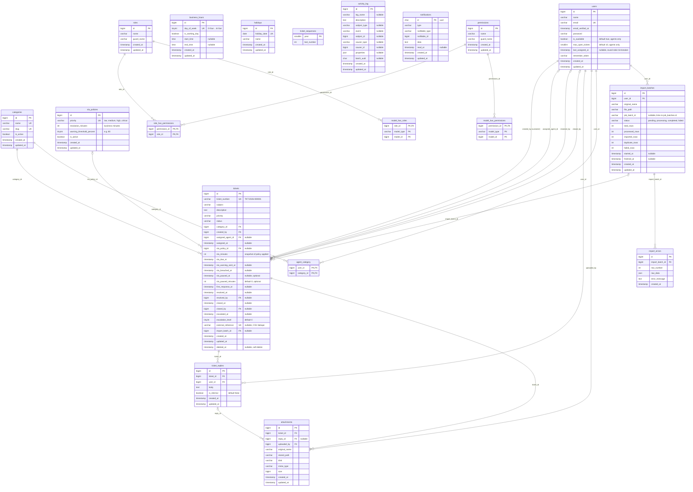

# Support Ticket & SLA System - ERD

## Indexes

**tickets**
- `(status, assigned_agent_id)` - agent queues, unassigned list
- `(status, sla_due_at)` - escalation scheduler
- `(created_by, status)` - customer views
- `(category_id, status)`, `(priority, status)`, `created_at`
- Unique: `ticket_number`, `external_reference` (nullable)

**ticket_replies**: `(ticket_id, created_at)`, optionally `(ticket_id, is_internal)`

**attachments**: `ticket_id`, `reply_id`

**notifications**: `(notifiable_type, notifiable_id)` (Laravel default)

**activity_log**: `(subject_type, subject_id)`, `(causer_type, causer_id)`, `log_name`

**import_errors**: `import_batch_id`

**users**: `(is_available, last_assigned_at)` - auto-assignment

## Design notes

1. SLA deadlines are computed in business minutes using `business_hours` and `holidays`.
2. `sla_minutes` is a snapshot of the policy applied; recalculate only on priority change.
3. `sla_paused_*` columns are optional (only for pausing on "Waiting for Customer").
4. `agent_category` is optional (only for category-based auto-assignment).
5. Concurrent assignment: atomic `UPDATE ... WHERE assigned_agent_id IS NULL` or `lockForUpdate()` in a transaction.
6. Ticket numbers: increment `ticket_sequences` inside a transaction with a row lock.
