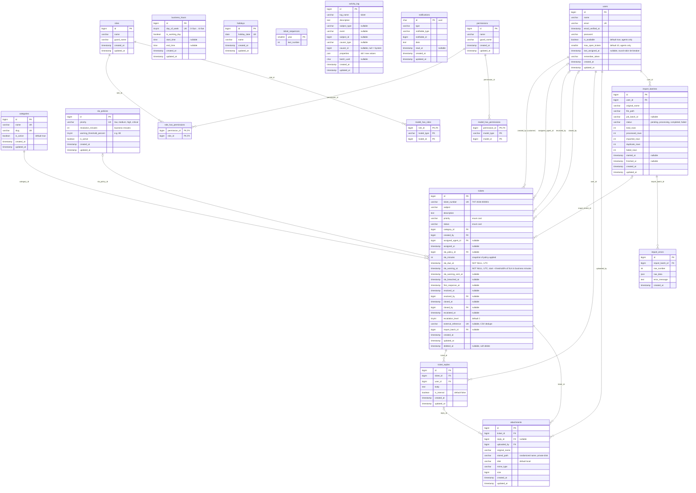

# Support Ticket & SLA System - ERD (refined)

## Scope decisions

| Item | Decision |
|---|---|
| `agent_category` | Removed. Auto-assignment uses workload + availability, not category skills. Future work. |
| `sla_paused_at`, `sla_paused_minutes` | Removed. The SLA clock is not paused on "Waiting for Customer". Documented limitation. |
| `holidays` | Kept. `SlaCalculator` skips holiday dates (one extra check in the day loop). |
| Soft deletes on `tickets` | Kept in the schema only. No delete UI is built. |
| `external_reference` | Globally unique (nullable). Used for CSV duplicate detection. |
| `sla_due_at` | NOT NULL. `sla_due_at` and `sla_warning_at` are both computed by `SlaCalculator` in the factory, seeder, `TicketService::create()` and the CSV import before insert. |

## Foreign key on-delete rules

| Column | Rule | Why |
|---|---|---|
| `tickets.created_by` | restrictOnDelete | Never lose the ticket owner |
| `tickets.category_id` | restrictOnDelete | Deactivate categories (`is_active`) instead of deleting |
| `tickets.assigned_agent_id` | nullOnDelete | Ticket returns to the unassigned queue |
| `tickets.resolved_by`, `tickets.closed_by` | nullOnDelete | History stays, actor reference cleared |
| `tickets.sla_policy_id` | nullOnDelete | `sla_minutes` snapshot keeps the applied SLA |
| `tickets.import_batch_id` | nullOnDelete | Tickets outlive the import record |
| `ticket_replies.ticket_id` | cascadeOnDelete | Replies belong to the ticket |
| `ticket_replies.user_id` | restrictOnDelete | Keep conversation authorship |
| `attachments.ticket_id`, `attachments.reply_id` | cascadeOnDelete | Attachments belong to ticket or reply |
| `attachments.uploaded_by` | restrictOnDelete | Keep uploader |
| `import_batches.user_id` | restrictOnDelete | Keep who ran the import |
| `import_errors.import_batch_id` | cascadeOnDelete | Errors belong to the batch |

## Indexes

Each index maps to a real query.

**tickets**
- Unique: `ticket_number`, `external_reference` (nullable; MySQL allows many NULLs in a unique index)
- `(status, sla_due_at)`: escalation scheduler, SLA status filters, dashboard breach counts
- `(status, sla_warning_at)`: approaching-breach filter and warning scheduler
- `(assigned_agent_id, status)`: agent queue, workload count for auto-assign, unassigned queue (`assigned_agent_id IS NULL`)
- `(created_by, status)`: customer "my tickets"
- `(priority, status)`: dashboard by priority, Critical count
- `(category_id, status)`
- `(created_at)`: date filters and default sorting
- FULLTEXT `(subject, description)`: keyword search (MySQL/MariaDB only)

**ticket_replies**
- `(ticket_id, is_internal, created_at)`: the customer view filters `is_internal = false` and sorts by time

**attachments**
- `(ticket_id)`, `(reply_id)`

**import_errors**
- `(import_batch_id, row_number)`

**users**
- `(is_available, last_assigned_at)`: auto-assignment lookup

**activity_log** (Spatie defaults plus one follow-up migration)
- Defaults: `(subject_type, subject_id)`, `(causer_type, causer_id)`, `log_name`
- Added: `(subject_type, subject_id, created_at)`: the timeline query "all entries for this ticket, newest first"

**notifications**
- `(notifiable_type, notifiable_id)` (Laravel default)

## Activity log conventions

- `log_name = 'ticket'`, `subject` = the ticket, `causer` = the user (null is displayed as "System").
- `properties = {"old": {...}, "new": {...}}`.
- Event vocabulary: `created`, `assigned`, `unassigned`, `status_changed`, `priority_changed`, `replied`, `note_added`, `attachment_added`, `sla_warning`, `escalated`, `resolved`, `closed`, `reopened`.
- All entries are written through `TicketActivityLogger`, never by calling `activity()` directly.

## Design notes

1. SLA deadlines are computed in business minutes from `business_hours` and `holidays`. Times are stored in UTC and calculated in `Asia/Dhaka`.
2. `SlaCalculator` is a pure class. It receives a cached config object (business hours, holidays, policies) and never queries the database inside its loop.
3. `sla_minutes` is a snapshot of the policy applied at creation. On a priority change, `sla_due_at` is recomputed from `created_at` with the new priority's minutes.
4. SLA status is derived from plain indexed queries over `sla_warning_at`, `sla_due_at` and `status`:
   - approaching: `sla_warning_at <= now AND sla_due_at > now AND status not in (resolved, closed)`
   - breached: `sla_due_at < now AND status not in (resolved, closed)`
   - within SLA: `sla_warning_at > now AND status not in (resolved, closed)`
5. Idempotent escalation: `sla_warning_sent_at`, `sla_breached_at` and `escalated_at` are set with guarded updates (`whereNull(...)`), so overlapping scheduler runs cannot notify twice.
6. Ticket numbers: increment `ticket_sequences` for the current year inside a transaction with `lockForUpdate()`. Insert the year row with `insertOrIgnore` first, because `lockForUpdate` cannot lock a row that does not exist yet. The unique index on `ticket_number` is the safety net.
7. Attachment visibility is derived from the reply (`reply.is_internal`), not duplicated on the attachment.
8. Agent visibility: agents see unassigned tickets plus their own. Admins see all. Customers see only tickets where `created_by` is themselves.
9. On priority change, recompute `sla_due_at` and `sla_warning_at`, then call `resetSlaTracking()` if the new due time is in the future.
10. Assignment: auto-assignment runs inside one `DB::transaction`, selects the candidate agent with `lockForUpdate()`, re-checks the open ticket count against `max_open_tickets`, then performs the atomic `UPDATE tickets SET assigned_agent_id = ?, assigned_at = now() WHERE id = ? AND assigned_agent_id IS NULL` and checks the affected row count. Manual claim uses the same atomic `UPDATE ... WHERE assigned_agent_id IS NULL` and affected-rows check. If 0 rows were affected, the ticket was already taken.
11. Attachments with `reply_id` NULL are ticket-level and always visible to the customer. Internal files must be attached through an internal note (reply with `is_internal = true`); visibility is derived from the reply.
12. CSV import: catch the unique-violation on `external_reference` and count it as a duplicate, because two chunks can race even after a pre-check.
13. Internal notes never leak: the customer timeline excludes the `note_added` event, note bodies are never stored in activity properties, customers are never notified of internal notes, and `first_response_at` is set only by the first public (`is_internal = false`) reply from someone other than the ticket creator.
14. `escalation_level`: 0 = none, 1 = warning sent (approaching SLA), 2 = breached. Warning and breach notifications go to the assigned agent and all administrators; if the ticket is unassigned, to administrators only.

## CSV import format

Required columns: `subject`, `description`, `priority`, `category_slug`, `customer_email`. Optional columns: `status`, `external_reference`, `created_at`.

- Customer is resolved by email; an unknown email is a row error (users are not auto-created).
- Category is resolved by slug; an unknown slug is a row error.
- A duplicate `external_reference` is counted as a duplicate, not an error.
- Invalid rows go to `import_errors` with `row_number` and `raw_data`.
- The import computes `sla_due_at` and `sla_warning_at` with `SlaCalculator`.

## Not implemented (future work)

- Pausing the SLA clock on "Waiting for Customer" (needs `sla_paused_at`, `sla_paused_minutes`)
- Category-based agent routing (`agent_category` pivot)
- Holiday management UI (holidays are seeded)
